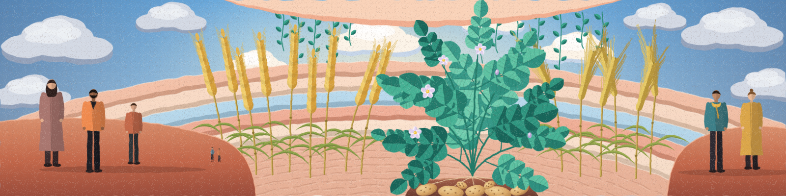

# Agricultural Market Resilience in Germany

*A Comparative Analysis of Soft Wheat, Barley and Potato Markets*

# Project Overview

**Problem.**  Agricultural markets are exposed to external shocks that can disrupt supply chains, increase price volatility, and affect domestic production and trade. However, the effects of these shocks may differ across agricultural commodities, as markets vary in their vulnerability and capacity to adjust to changing conditions. Comparing soft wheat, barley, and potato markets in Germany can provide insights into these differences and their implications for market resilience.

**Goal.**  Analyze the economic mechanisms of selected agricultural commodities across three dimensions and throughout the pre-crisis, crisis, and post-crisis phases to answer the following research questions.

1. Availability and Supply Balance. How do domestic production, imports, exports, stocks, and domestic use change?
2. Price Stability. How do the three agricultural markets differ in their vulnerability to external shocks and their capacity to adapt?
3. Adjustment and Recovery. How do supply balances and prices evolve during and after crises, and how quickly do they return toward pre-crisis conditions?

**Approach.**  Data collection and preparation, exploratory analysis, and visualisation of market and price dynamics, as well as international trade dependencies, to investigate shock magnitude, response timing, shock duration, and recovery patterns.

## Conceptual Framework: Risk Categories and Transmission Mechanisms

There is no single universally applicable classification of all crises affecting agricultural markets. This overview draws on established institutional frameworks, particularly the OECD's agricultural risk management framework and the FAO's work on agricultural supply chains. The categories below provide a structured synthesis rather than a verbatim reproduction of one official taxonomy.

| **Risk Category**                   | **Examples of Risk Drivers**                                          | **Potential Transmission Mechanisms**                                     |
| ----------------------------------- | --------------------------------------------------------------------- | ------------------------------------------------------------------------- |
| **Production Risks**                | Droughts, heatwaves, floods, pests and diseases                       | Crop yields, production volumes and domestic supply                       |
| **Market and Price Risks**          | Shifts in supply and demand, global commodity price shocks and market disruptions              | Transmission of international price changes to domestic producer prices, changes in farm revenues and production incentives                     |
| **Input Cost Risks**                | Energy, fertiliser, fuel and other input price increases              | Production costs, input use and production decisions                      |
| **Trade and Supply Chain Risks**    | Export restrictions, transport disruptions and logistical bottlenecks | Import availability, trade flows, delivery times and transport costs      |
| **Financial Risks**                 | Interest rate changes, credit constraints and liquidity shortages     | Financing costs, investment and farm liquidity                            |
| **Policy and Institutional Risks**  | Changes in agricultural, trade or environmental policies              | Market incentives, trade conditions and production decisions              |
| **Geopolitical and Systemic Risks** | Armed conflicts, pandemics and major cross-border economic disruptions     | Disruptions to energy and input supplies and prices; labour shortages, interruptions to international trade, shifts in aggregate demand |

*Conceptual sources: [OECD – Strengthening Agricultural Resilience in the Face of Multiple Risks (2020)](https://doi.org/10.1787/2250453e-en) · [FAO – Guidelines to Increase the Resilience of Agricultural Supply Chains](https://www.fao.org/markets-and-trade/areas-of-work/emerging-trends-challenges-and-opportunities/guidelines-to-increase-the-resilience-of-agricultural-supply-chains/).The risk categories presented here constitute a structured synthesis of established institutional frameworks and may overlap. They do not represent a single, universally adopted official classification. The risk drivers illustrate factors and developments that may generate or amplify risks, while the transmission mechanisms describe potential pathways through which these risks may affect agricultural markets. Their relevance and empirical effects on the German soft wheat, barley and potato markets will be investigated in this project. Additional sources: [FAO – Agricultural Commodity Markets](https://www.fao.org/publications/fao-flagship-publications/the-state-of-agricultural-commodity-markets/) · [European Commission – Fertiliser Markets](https://agriculture.ec.europa.eu/data-and-analysis/markets/overviews/market-observatories/fertilisers_en) · [UNCTAD – Maritime Trade Disruptions](https://unctad.org/system/files/official-document/rmt2024_en.pdf). These sources provide complementary perspectives and inform the synthesis developed for this project.*

# Historical Events and Potential Market Transmission (1990–2026)

| **Period** | **Historical event or development** | **Primary risk category** | **Secondary risk category** | **Potential transmission mechanism** | **Empirical research focus** | **Sources** |
| ------------------ | ----------------------------------------------------------------- | ------------------------------- | ------------------------------- | ------------------------------------------------------------------------------------------------------------------------------------------------------------------------------------------------ | ------------------------------------------------------------------------------------------------------------------------------------------------------ | ------------------------------------------------------------------------------------------------------------------------------------------------------------------------------------------------------------------------------------------------------------------------------------------------------------------------------------------------------------------------------------------------------------------------------------------------------------------------------ |
| 1990–1991 | German reunification and restructuring of East German agriculture | Policy and Institutional Risks | Market and Price Risks | Institutional transition and integration into market-based agricultural systems could alter production structures, market access and farm revenues. | Examine structural changes in production, trade and supply balances; distinguish long-term transformation from discrete shocks. | [DIW Berlin – DDR-Landwirtschaft vor erneutem Umstrukturierungsprozess (1990)](https://www.diw.de/de/diw_01.c.486342.de/publikationen/wochenberichte/1990_33_3/ddr-landwirtschaft_vor_erneutem_umstrukturierungsprozess.html); [German reunification treaty, agricultural provisions](https://www.gesetze-im-internet.de/einigvtr/BJNR208890990BJNE027800301.html) |
| 1992–1994 | Common Agricultural Policy (CAP) reform | Policy and Institutional Risks | Market and Price Risks | The shift from price support towards direct payments could change market incentives and agricultural production decisions. | Examine changes in production, prices and supply around implementation, accounting for concurrent structural developments. | [European Commission – CAP at a glance](https://agriculture.ec.europa.eu/common-agricultural-policy/cap-overview/cap-glance_en) |
| 2003 | Severe drought and heatwave in Germany | Production Risks | Market and Price Risks | Heat and water stress could reduce yields and harvest volumes, potentially affecting domestic availability and prices. | Measure crop-specific yield and production deviations, price movements and supply adjustment. | [Umweltbundesamt – Yield fluctuations](https://www.umweltbundesamt.de/en/monitoring-on-das/cluster/agriculture/lw-I-2/indicator) |
| 2007–2008 | Global food price crisis | Market and Price Risks | Trade and Supply Chain Risks | International commodity-price movements and changing global supply-demand conditions could transmit to domestic agricultural prices. | Compare international and German prices, volatility, trade flows and adjustment patterns. | [FAO – The State of Agricultural Commodity Markets 2009](https://www.fao.org/4/i0854e/i0854e00.htm); [FAO – Price volatility in agricultural markets](https://www.fao.org/markets-and-trade/areas-of-work/emerging-trends-challenges-and-opportunities/agricultural-policy/price-volatility-in-agricultural-markets%282%29/en) |
| 2018–2019 | Severe drought and heat stress in Germany | Production Risks | Market and Price Risks | Weather extremes could affect crop development, yields and harvest volumes, with potentially different effects across crops and regions. | Compare yields, production, prices and supply balances against historical baselines; assess persistence from 2018 into 2019. | [Umweltbundesamt – Yield fluctuations](https://www.umweltbundesamt.de/en/monitoring-on-das/cluster/agriculture/lw-I-2/indicator) |
| 2020–2021 | COVID-19 pandemic and related restrictions | Geopolitical and Systemic Risks | Trade and Supply Chain Risks | Labour constraints, logistical disruption and changes in food-service and household demand could affect agricultural supply chains and market demand. | Examine trade, domestic use and prices; distinguish pandemic-related developments from other simultaneous market changes. | [European Commission – EU agri-food trade during COVID-19 and Brexit challenges](https://agriculture.ec.europa.eu/media/news/slight-increase-eu27-agri-food-trade-despite-coronavirus-and-brexit-challenges-2020-09-10_en); [FAO – Guidelines to increase the resilience of agricultural supply chains](https://www.fao.org/markets-and-trade/areas-of-work/emerging-trends-challenges-and-opportunities/guidelines-to-increase-the-resilience-of-agricultural-supply-chains/) |
| 2021–2022 | Energy and fertiliser price shock | Input Cost Risks | Market and Price Risks | Higher energy, fertiliser and fuel costs could affect farm production costs, input use, storage and production decisions. | Examine input-price developments and their potential association with production, commodity prices and delayed supply responses. | [European Commission – Fertiliser markets](https://agriculture.ec.europa.eu/data-and-analysis/markets/overviews/market-observatories/fertilisers_en); [European Commission – Safeguarding food security and reinforcing the resilience of food systems (2022)](https://eur-lex.europa.eu/legal-content/EN/TXT/?uri=CELEX:52022DC0133) |
| From February 2022 | Russia’s full-scale invasion of Ukraine | Geopolitical and Systemic Risks | Trade and Supply Chain Risks | Disruptions and uncertainty affecting grain exports, energy and fertiliser markets could influence international prices, trade conditions and production costs. | Examine trade dependencies, availability, prices and adjustment patterns; account for overlap with the energy and fertiliser price shock. | [European Commission – Safeguarding food security and reinforcing the resilience of food systems (2022)](https://eur-lex.europa.eu/legal-content/EN/TXT/?uri=CELEX:52022DC0133) |
| 2022–2024 | Inflation and persistent food-price pressures | Market and Price Risks | Input Cost Risks | Changes in energy, input, processing and distribution costs, alongside demand and market adjustments, could influence agricultural and consumer prices. | Examine price transmission and persistence; distinguish observed price movements from their possible underlying causes. | [Destatis – Consumer price index: food and non-alcoholic beverages](https://www.destatis.de/EN/Themes/Economy/Short-Term-Indicators/Prices/kpre520.html); [Destatis – Inflation rate in 2022](https://www.destatis.de/EN/Press/2023/01/PE23_022_611.html) |
| Late 2023–2024 | Red Sea and Suez Canal shipping disruptions | Trade and Supply Chain Risks | Geopolitical and Systemic Risks | Rerouting ships and longer transport routes could increase freight costs and delivery times for goods moving along affected routes. | Establish Germany’s direct exposure through relevant imports, exports and agricultural inputs before testing potential market effects. | [UNCTAD – Review of Maritime Transport 2024](https://unctad.org/publication/review-maritime-transport-2024); [UNCTAD – Red Sea crisis and trade implications (2024)](https://unctad.org/news/red-sea-crisis-and-implications-trade-facilitation-africa) |
| 2024 | Annual harvest variation in German cereals and potatoes | Production Risks | Market and Price Risks | Weather conditions, cultivated area, yields and crop-specific growing conditions could contribute to changes in domestic supply. | Assess crop-specific harvest volumes and yields, then determine whether observed deviations represent a meaningful shock or ordinary annual variation. | [Destatis – Field crops and grassland statistics](https://www.destatis.de/EN/Themes/Economic-Sectors-Enterprises/Agriculture-Forestry-Fisheries/Field-Crops-Grassland/_node.html) |
| 2025 | Annual harvest variation in German cereals and potatoes | Production Risks | Market and Price Risks | Changes in yields, cultivated area and harvest conditions could alter annual crop availability and supply. | Include 2025 as an additional observation year; assess production and supply outcomes without presuming that the year constitutes a crisis. | [Destatis – Grain and potato harvest](https://www.destatis.de/EN/Themes/Economic-Sectors-Enterprises/Agriculture-Forestry-Fisheries/Field-Crops-Grassland/grain-potato-harvest.html) |
| 2026 | Iran war and related disruptions to energy markets and international shipping | Geopolitical and Systemic Risks | Input Cost Risks | Disruptions to energy supplies, shipping routes and fertiliser markets could affect energy and fertiliser prices, transport costs and agricultural production costs in Germany. These cost pressures could subsequently influence farm decisions and agricultural prices, potentially with time lags. | Examine energy and fertiliser price developments before and after the escalation, alongside monthly producer prices and available trade indicators for soft wheat, barley and potatoes. Distinguish observed price changes from potential conflict-related effects and account for overlapping geopolitical and market developments. | [Destatis – Import prices in March 2026](https://www.destatis.de/EN/Press/2026/04/PE26_151_614.html); [Destatis – Import prices in April 2026](https://www.destatis.de/EN/Press/2026/05/PE26_180_614.html); [European Commission – Fertiliser markets](https://agriculture.ec.europa.eu/data-and-analysis/markets/overviews/market-observatories/fertilisers_en) |

*Note: The timeline identifies historical events and developments as potential cases for analysing agricultural market resilience in Germany. Risk categories follow the project's conceptual framework. Transmission mechanisms indicate potential pathways rather than confirmed effects. The actual impacts on soft wheat, barley and potato markets will be assessed empirically using production, trade, stock and price data. Overlapping events are not assumed to represent independent causes. The 2026 Iran-war entry reflects a current geopolitical shock; the cited Destatis releases document changes in German import prices and identify conflict-related energy and fertiliser price pressures, but do not by themselves establish causal effects on the three agricultural markets examined in this project.*

# Rationale for Data Selection and Observation Periods

The data selection is guided by the project's three research dimensions: **Availability and Supply Balance, Price Stability, and Adjustment and Recovery**. Rather than relying on a single indicator, the analysis integrates agricultural production and yield statistics, supply balances, foreign-trade data, agricultural price series, and input price indices. This multidimensional approach provides a basis for examining market developments and comparing soft wheat, barley and potatoes in Germany.

## Historical Data Horizon and Observation Periods

Where sufficiently comparable observations are available, historical data extending back to 1991 are retained to provide long-term context and help assess whether more recent market developments differ from earlier fluctuations. The 2003 drought and heatwave in Germany are considered as part of this historical context, illustrating the relevance of production-related disturbances. However, 2003 is not a primary case in the quantitative comparative analysis. This distinction avoids treating the subsequent years as a recovery period without first establishing whether the relevant market indicators support such an interpretation.

The main comparative business intelligence analysis covers the period from 2008 to 2025, subject to the availability and comparability of the individual datasets. This period is consistent with the available Destatis series for monthly foreign trade and provides a common starting point for the core trade analysis. Individual price, production and supply indicators may cover longer or shorter periods, depending on their historical availability and reporting frequency. Accordingly, the historical data horizon and the observation period of the main analysis are not necessarily identical.

## Data Selection and Analytical Purpose

Each dataset is selected according to its contribution to the research dimensions. Supply balances provide information on production, trade and domestic use. Harvest statistics capture changes in cultivated area, yields and production volumes. Foreign-trade statistics enable the analysis of imports and exports, including monthly fluctuations. Agricultural price series support the examination of price movements and volatility, while input price indices provide context for potential cost-related transmission mechanisms.

The datasets differ in frequency, product definitions, reporting periods and historical coverage. These differences will be documented during data preparation and considered when selecting indicators and interpreting results. Where reporting periods or product categories cannot be aligned sufficiently, comparisons will be restricted to those supported by the available data. Agricultural marketing years and calendar years will not be treated as interchangeable without appropriate justification.

## Selection of Historical Events and Potential Transmission Mechanisms

The project uses selected historical disturbances to examine how market developments may coincide with different types of shocks. The primary cases are the 2018 drought and heatwave in Germany and the energy, input-cost and geopolitical disturbances that intensified from 2021 onwards, including Russia's full-scale invasion of Ukraine in February 2022. The COVID-19 period from 2020 to 2021 may be included as an additional case where time and data availability permit.

These cases represent different but potentially overlapping transmission mechanisms. Weather-related production shocks may be reflected in yields and harvest volumes. Trade and supply-chain disruptions may coincide with changes in import and export quantities, while increases in energy and fertiliser prices may influence production costs and subsequent production decisions. These relationships are treated as hypotheses rather than assumed causal effects. The temporal coincidence of an event with a change in prices, production or trade is not sufficient to establish causality.

## Comparative Assessment of Pre-Crisis, Crisis and Post-Crisis Periods

Pre-crisis, crisis and post-crisis periods will be defined separately for each selected case, taking into account the timing of the disturbance, the expected delay between the event and its potential market effects, and the availability of comparable observations. The same time windows will not automatically be applied to every event or commodity. Initial observation windows will be adjusted where necessary to reflect the frequency of the data and the characteristics of each market.

Potential reference periods will be evaluated using the relevant indicators rather than assumed to represent normal market conditions in advance. Adjustment and recovery will be assessed only where the available observations support a meaningful comparison with the selected reference period. A return towards an earlier price or production level will not, on its own, be interpreted as evidence that all dimensions of market resilience have been restored.

Finally, the analysis distinguishes between documented historical events, observed market developments and causal explanations. Because multiple disturbances may overlap, descriptive time-series analysis alone cannot isolate their individual effects. The main quantitative analysis ends in 2025. Data for 2026 may be used for supplementary context where sufficiently complete and comparable observations are available, but will not be treated as a complete post-event period when the evidence is insufficient to assess adjustment and recovery reliably.

## Data Sources

### 1. Availability and Supply Balance

This dimension uses publicly available official statistics for Germany.

**BMELH – Official Agricultural Statistics (Production Balance, Market Balance, Overall Balance, Financial Year, 2011-2025)**

[*Soft Wheat - Barley Supply Balance*](https://www.bmel-statistik.de/ernaehrung/versorgungsbilanzen/getreide) | [*Potato Supply Balance*](https://www.bmel-statistik.de/ernaehrung/versorgungsbilanzen/kartoffeln)

**BLE – Open Data (Overall supply balance, Financial Year, 1991-2025)**

[*Soft Wheat - Barley Supply Balance*](https://open-data.ble.de/dataset/versorgungsbilanz-getreide) | [*Potato Supply Balance*](https://open-data.ble.de/dataset/versorgungsbilanz-kartoffeln)

**DESTATIS - Harvest and Farm Report (Area under Cultivation, Production, Yield, Year, 2010-2026)**

[*Winter Wheat - Spring Wheat - Winter Barley - Summer Barley - Potato*](https://genesis.destatis.de/datenbank/online/url/fb99c6a2)

**DESTATIS - Foreign Trade Statistics (Monthly, 2008-2025)**

[*Foreign Trade Wheat and Meslin - Barley - Potato*](https://genesis.destatis.de/datenbank/online/url/aeb0bf5d)

**Methodological references**

**Agricultural commodity balances:** [BMEL – Grundlagen der Versorgungsbilanzen](https://www.bmel-statistik.de/ernaehrung/versorgungsbilanzen/grundlagen)

**Foreign trade product classification:** [Destatis – Warenverzeichnis für die Außenhandelsstatistik](https://www.destatis.de/DE/Methoden/Klassifikationen/Aussenhandel/warenverzeichnis-aussenhandel.html)

### 2. Price Stability

**DESTATIS - Price Index (Monthly, 2020=100, 1991-2026)**

[*Price Index Bread Wheat - Feed Wheat - Feed Barley - Malting Barley - Seed Potato - Ware Potato*](https://genesis.destatis.de/datenbank/online/url/465076c8)

**BMELH - Agricultural Producer Prices (Year, 2009-2024)**

[*Soft Wheat - Barley - Malting Barley - Ware Potato*](https://bmel-statistik.de/preise/absolute-agrarpreise?utm_source=chatgpt.com)

**FAOSTAT - AGricultural Producer Prices (Monthly, 1991-2026)**

[*Wheat - Barley - Potato*](https://www.fao.org/faostat/en/#data/PP)

**DESTATIS - Purchase Price Indices of Agricultural Inputs (Quarterly, 2020=100, 1991-2026)**

[*Energy and Lubricants - Fertiliser*](https://genesis.destatis.de/datenbank/online/url/a049c6fc)

## Methodology and Analytical Framework

## Analysis and Visualisations

## Key Findings and Limitations

### Limitations

- **Differences in Product Classifications:** The data sources use different product classifications and levels of aggregation. For example, wheat and barley statistics may distinguish between crop types or intended uses, while potato statistics follow their own product definitions. Direct comparisons are therefore only appropriate where the underlying definitions are sufficiently comparable.

- **Data Availability and Coverage:** Historical coverage varies across sources and indicators. The effective analysis period may consequently differ depending on data availability and the research question.

- **Differences in Reporting Periods and Frequency:** The datasets include annual, monthly and quarterly observations and may refer to calendar years or agricultural and marketing years. These differences must be considered when aligning observations and defining crisis and recovery periods.

- **Differences in Price Measures:** Price indices and absolute producer prices measure different aspects of price development. Comparisons require consideration of their units, reference periods, product definitions and statistical methodologies.

- **Descriptive Nature of the Analysis:** The analysis identifies patterns and potential relationships between production, trade, prices and input costs. However, descriptive time-series analysis alone cannot establish that specific crises caused the observed market changes.

- **Assessment of Market Resilience:** The assessment depends on the selected indicators, reference periods and availability of post-crisis data. Changes in production, supply or prices capture only selected dimensions of resilience and do not necessarily establish the overall capacity of a market to absorb, adapt to or recover from shocks.

- **Incomplete Data for Recent Periods:** Data for the most recent period may be incomplete, preliminary or subject to revision. The main quantitative analysis therefore focuses on 2008–2025, subject to the coverage and comparability of the individual datasets. More recent observations may be included as supplementary context where appropriate.

## Project Status

* 🟢 Project Concept
* 🟢 Data Collection
* 🟢 Data Exploration
* 🟡 Data Cleaning and Preparation
* 🔴 Data Analysis
* 🔴 Data Visualisation
* 🔴 Final Report and Insights

**Legend:** 🟢 Completed · 🟡 In Progress · 🔴 Not Started

# Author

Kordula Pfeiffer. Agricultural and Food Economist. [LinkedIn.](https://www.linkedin.com/in/kordulapfeiffer/)

